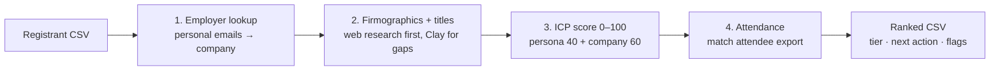

# Webinar Lead Enrichment: from registrant list to ranked follow-up

> **Outcome:** a raw webinar or event registrant list becomes a ranked, sales-ready CSV. Every lead gets an ICP score, a tier and a next action, and the people who registered with Gmail addresses get their employers found instead of being ignored.

A [Claude skill](https://docs.claude.com/en/docs/agents-and-tools/agent-skills/overview) plus a Python scoring script that I built for the hours right after a webinar, when sales asks *"who should we call first?"*

---

## The problem

Registrant lists are full of `@gmail.com` addresses with no company, titles typed by hand, and no sense of who actually matters. Teams either follow up with everyone the same way, or only with the obvious CFOs. Either way they miss the controller at a perfect-fit company who registered with a personal email.

## How it works



1. **Employer lookup.** Uses clues in the email address (business names, `cpa` designations, country domains), with **confidence levels** and a firm rule: *never invent a URL.*
2. **Enrichment.** Fans out to parallel research agents, uses web search first, and uses Clay only for the gaps. It plans around search limits and marks unfinished rows as `Partial` rather than hiding them.
3. **Scoring.** Persona fit (0–40) plus company fit (0–60): industry, revenue sweet spot, multi-entity complexity, geography, and resemblance to existing customers. Low-confidence matches are scored down, and excluded industries are capped at Tier C.
4. **Attendance.** Matches the attendee export by normalized name. High-tier registrants who didn't attend get "send recording first."

## Example

`scripts/score_leads.py` on 11 made-up registrants ([`examples/`](examples/)):

| Rank | Tier | Score | Who | Why |
|---|---|---|---|---|
| 1 | A | 92 | Head of FP&A, Bluepeak Software | Finance leader, SaaS, right size, lookalike |
| 3 | A | 84 | Financial Controller, Lumen Analytics | **Registered with Gmail.** Employer found (medium confidence, scored down) and still Tier A |
| 6 | C | 54 | CFO, Upland Manufacturing | Perfect title, **excluded industry**, capped at C |
| 7 | C | 48 | Director of Finance, GlobalCorp | Flagged: enterprise above ICP size |
| 9 | P | n/a | Partner, Brightledger Advisory | Accounting firm → partner/channel, not sales |
| 11 | U | n/a | Gmail, no employer found | Left unscored, not guessed |

```
tiers: A 4 · B 1 · C 3 · P 1 · D 1 · U 1
```

## Rules that came from real mistakes

- **Never match on an empty domain or name.** It matches everything.
- **No partial matching on company names.** "EY" matches half the alphabet. Use exact names or domains only.
- **Check customer matches by domain.** A short acronym domain often belongs to someone else.
- **Keep every original row and column.** Only add columns, never overwrite, so sales can trust the file.
- **Flag duplicate people; don't delete them.** Same name, two emails might be one person or two.

## What's in the repo

| Path | What it is |
|---|---|
| `SKILL.md` | The four-stage workflow Claude follows, including research fan-out and Clay batching |
| `icp-config.md` | The example ICP and scoring weights. Swap in your own. |
| `scripts/score_leads.py` | Standalone scorer: persona + company fit → score, tier, next action, flags, with built-in checks |
| `examples/` | Made-up enriched registrants and the ranked output |

## Use it

```bash
python3 scripts/score_leads.py examples/enriched-registrants.csv ranked.csv
```

For the full workflow, add the folder to your Claude skills and ask: *"Enrich and rank this webinar registrant list."*

---

*Part of my [event ops toolkit](https://github.com/parker-lauren): [run the program](https://github.com/parker-lauren/event-program-os) → [vet the event](https://github.com/parker-lauren/event-vetting) → **enrich the leads** → [clean the list](https://github.com/parker-lauren/event-contact-list) → [debrief honestly](https://github.com/parker-lauren/event-debrief). All people, companies and data here are made up.*
